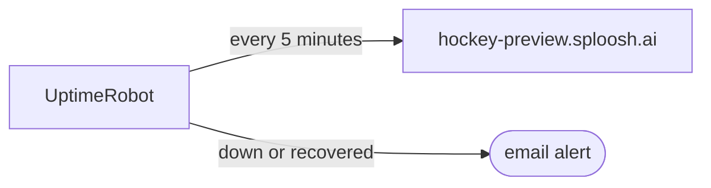

# Monitoring and analytics

**Last updated:** 2026-11-25

## Uptime

UptimeRobot, HTTP checks every 5 minutes, email alerts. Monitored: `https://hockey-preview.sploosh.ai/`.
There is no separate public production address at this time.

## Analytics and error tracking

None. No analytics service or error tracking runs in the app. If one is added, record the events here and
what is never collected.
